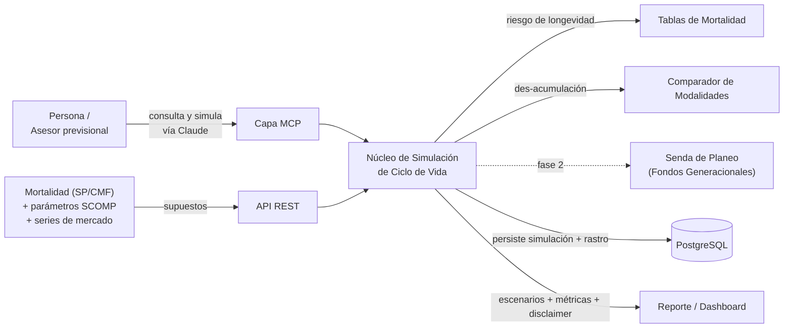
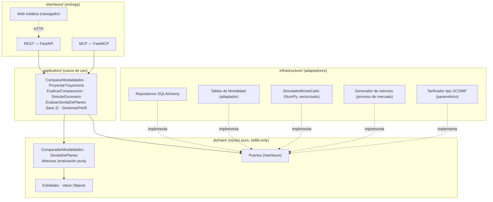
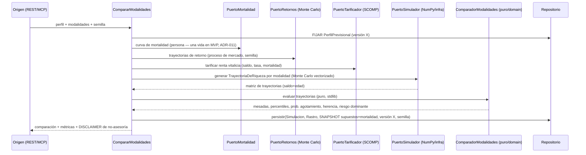
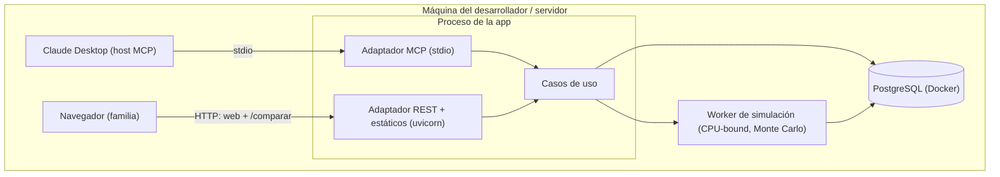

# SAD — Cauce · Motor de Ciclo de Vida Previsional (Acumulación + Des-acumulación) + Capa MCP

> **Documento de Arquitectura de Software (Software Architecture Document)**
> Estructura: arc42 · Versión: 0.2 (draft) · Estado: propuesto para implementación
> Proyecto: **Cauce** (identificador técnico: `cauce`) · *(nombre confirmado — el cauce por el que fluyen los ahorros a lo largo de la vida; INAPI sin marca vigente en las clases núcleo 9 y 36; vigilar la clase 41 si se acentúa el ángulo educativo. Verificar dominio/handles antes de registro formal.)*
> Hub de contexto: ver [`CLAUDE.md`](./CLAUDE.md) y [`MEMORY.md`](./MEMORY.md)
> Origen: *"Target-Date Funds: A State-of-the-Art Review with Policy Applications to Chile's Pension Reform"* (Suárez, Peña & Larré, Fintual AGF, 2025) + marco regulatorio de la **Ley N° 21.735** (Reforma Previsional 2025) y las modalidades de pensión del **SCOMP** (Superintendencia de Pensiones). Estudio paralelo de referencia: Cifuentes, Valencia, Reyes & Valenzuela (CLAPES UC, 2025).
> Ecosistema: cuarto motor analítico de la **vertical fintech** del autor, junto a Veredicto (decisión de crédito), Riesgora (carteras) y Vornay (dinámica competitiva). Reusa el molde de Veredicto.

---

## Tabla de contenido

1. [Introducción y objetivos](#1-introducción-y-objetivos)
2. [Restricciones](#2-restricciones)
3. [Contexto y alcance](#3-contexto-y-alcance)
4. [Estrategia de solución](#4-estrategia-de-solución)
5. [Vista de bloques de construcción](#5-vista-de-bloques-de-construcción)
6. [Vista de ejecución (runtime)](#6-vista-de-ejecución-runtime)
7. [Vista de despliegue](#7-vista-de-despliegue)
8. [Conceptos transversales](#8-conceptos-transversales)
9. [Decisiones de arquitectura (ADRs)](#9-decisiones-de-arquitectura-adrs)
10. [Requisitos de calidad](#10-requisitos-de-calidad)
11. [Riesgos y deuda técnica](#11-riesgos-y-deuda-técnica)
12. [Sistema de documentación viva](#12-sistema-de-documentación-viva)
13. [Hoja de ruta por fases](#13-hoja-de-ruta-por-fases)
14. [Glosario](#14-glosario)

---

## 1. Introducción y objetivos

### 1.1 Qué es esto

Un **motor de simulación del ciclo de vida previsional** que cubre las dos mitades de la vida financiera de una persona: la **acumulación** (cómo debería moverse la mezcla de riesgo de un fondo a lo largo de las décadas — la *senda de planeo* o glide path de los nuevos Fondos Generacionales) y la **des-acumulación** (cómo conviene transformar el saldo acumulado en pensión al jubilar — comparar retiro programado, renta vitalicia y modalidades mixtas).

La pieza que las une es un **núcleo de simulación estocástica compartido** con un único estado central, la **TrayectoriaDeRiqueza** (saldo + edad a lo largo del tiempo): lo que produce el módulo de acumulación es exactamente lo que consume el de des-acumulación. Esa continuidad es lo que hace que esto sea **un proyecto y no dos pegados**.

Incluye una **capa MCP** para interrogar y simular en lenguaje natural ("¿qué pasa con mi pensión si elijo renta vitalicia en vez de retiro programado?", "¿cuánto cambia si vivo 5 años más de lo esperado?").

**No es asesoría previsional ni recomendación personalizada.** Es un **simulador educativo y de análisis** que ilustra escenarios, trade-offs y sensibilidades, con trazabilidad — no le dice a una persona concreta qué modalidad contratar. La elección real es irrevocable y está reservada a procesos regulados (SCOMP, asesores previsionales registrados).

**MVP = el módulo de des-acumulación.** Es el que tiene el dolor más claro y humano (mucha gente toma a ciegas una decisión irreversible al jubilar), el mejor demo (un comparador interactivo) y está recién reformado (Ley 21.735). La acumulación entra como fase posterior **sobre el mismo núcleo**.

Tres capacidades núcleo:

- **Núcleo estocástico de ciclo de vida:** simular por Monte Carlo la TrayectoriaDeRiqueza dada una persona, retornos y mortalidad — el contrato común entre ambos módulos.
- **Comparador de modalidades (des-acumulación, MVP):** proyectar y contrastar las modalidades del SCOMP modelando **riesgo de longevidad** (tablas de mortalidad) y **riesgo de secuencia de retornos**.
- **Senda de planeo (acumulación, fase 2):** diseñar/evaluar la trayectoria de riesgo de un fondo generacional según edad **y riqueza acumulada** (la tesis central del paper de origen), no solo según edad.

### 1.2 Objetivos de calidad principales

| Prioridad | Atributo | Por qué es crítico aquí |
|-----------|----------|--------------------------|
| 1 | **Honestidad de producto / No-asesoría** | El producto debe ser educativo/ilustrativo. Recomendar una modalidad a una persona concreta roza la asesoría previsional regulada. Es el atributo dominante. |
| 2 | **Reproducibilidad / Determinismo** | Una simulación debe reconstruirse idéntica dados persona, supuestos, modelo y semilla Monte Carlo. Base de auditoría y comparación. |
| 3 | **Validez actuarial** | El valor diferenciador es modelar bien el riesgo de longevidad; una mortalidad mal modelada invalida toda la comparación de modalidades. |
| 4 | **Explicabilidad** | El usuario debe entender el *por qué* de cada resultado (qué riesgo domina cada modalidad); es lo que expone la capa MCP. |
| 5 | **Corrección numérica** | Tarificación y proyección deben ser verificables; nunca entregar una comparación sin sus supuestos y su diagnóstico. |

> **Nota de diseño (criterio senior):** las dos mitades **no chocan legalmente entre sí** — son complementarias. El riesgo legal real está en la des-acumulación (la elección de modalidad es irreversible y materia de asesoría regulada). Por eso el encuadre es **simulador, no asesor**: se muestran escenarios y sensibilidades, y se redirige a la AFP / asesor previsional registrado / SCOMP. El módulo de acumulación tiene riesgo bajo, porque bajo la nueva ley el afiliado **ni siquiera elige** su fondo obligatorio: ahí la herramienta es de diseño institucional y educación, no de recomendación.

### 1.3 Stakeholders

| Rol | Interés en la arquitectura |
|-----|----------------------------|
| Persona próxima a jubilar | Entender, con escenarios claros, la decisión irreversible que enfrenta (des-acumulación, B2C educativo). |
| Asesor previsional registrado | Herramienta de apoyo para ilustrar trade-offs a su cliente; el producto no lo reemplaza. |
| AFP / Compañía de Seguros de Vida / AGF | Diseño y simulación de fondos generacionales y de oferta de modalidades. |
| Superintendencia / análisis de política | Simular impacto de distintos diseños de senda/benchmark (acumulación). |
| Afiliado joven | Educación sobre cómo se ajusta su fondo con la edad (acumulación). |
| Compliance / Legal | Que el producto NO constituya asesoría previsional; trazabilidad de supuestos. |
| Ingeniería | Mantenibilidad, núcleo compartido limpio, módulos enchufables, testabilidad. |
| Autor (portafolio) | Demostrar madurez senior: simulación actuarial/financiera, arquitectura modular, IA/MCP, criterio regulatorio. |

---

## 2. Restricciones

### 2.1 Técnicas

- **Lenguaje:** Python 3.12+ (alineado a Veredicto/Riesgora; ecosistema quant/actuarial maduro).
- **Numérico:** NumPy + SciPy para la simulación Monte Carlo y la proyección; tablas de mortalidad propias o vía librería actuarial; **cvxpy** para la optimización de la senda de planeo (fase 2). **El cómputo vectorizado vive en `infrastructure/` detrás del `PuertoSimulador`, no en `domain/`** (ver ADR-010).
- **Tipado y validación:** Pydantic v2 en `application/`/`infrastructure/`/`interfaces/`. **`domain/` stdlib-only** (persona, trayectoria de riqueza, modalidades y la *evaluación* de una modalidad son puros; la *generación* numérica de trayectorias es de infraestructura). Esta es la diferencia con Veredicto/Riesgora, cuyo dominio de reglas sí cabía en stdlib sin tensión de rendimiento.
- **Web framework:** FastAPI. **MCP:** FastMCP (stdio local; HTTP + OAuth 2.1 remoto).
- **Persistencia:** SQLAlchemy 2.0 + PostgreSQL.
- **Inyección de dependencias:** `injector`. **Contenedores:** Docker. **Toolchain:** uv · ruff · mypy --strict · import-linter.

### 2.2 Organizativas / de proceso

- **Presupuesto bajo:** versión portafolio en ~USD 0 (local + free tiers; tablas de mortalidad y parámetros del SCOMP de fuentes públicas reguladas; series de mercado gratuitas/fixtures).
- **Metodología:** Specification-Driven Development.
- **Continuidad de contexto entre sesiones de IA** mediante documentación viva (§12).

### 2.3 Convenciones

- Idioma del dominio en **español** (Afiliado, SaldoPrevisional, SendaDePlaneo, ModalidadDePension, Mesada, RiesgoDeLongevidad); técnico en inglés cuando es idiomático.
- **Determinismo numérico explícito:** supuestos (retornos, inflación, tasa de descuento), tabla de mortalidad, modelo y **semilla Monte Carlo** se registran por simulación. Librerías versionadas para reproducibilidad en el mismo entorno.
- Toda comparación entregada **debe** venir con sus supuestos, sus métricas de riesgo y un **disclaimer de no-asesoría** explícito.

---

## 3. Contexto y alcance

### 3.1 Contexto de negocio



### 3.2 Alcance funcional (qué SÍ hace)

- Simular por Monte Carlo la **TrayectoriaDeRiqueza** de una persona (saldo + edad) bajo supuestos de retorno, inflación y mortalidad.
- **(MVP)** Proyectar y **comparar las modalidades de pensión del SCOMP** — retiro programado, renta vitalicia inmediata, renta temporal con renta vitalicia diferida, renta vitalicia inmediata con retiro programado — modelando longevidad y secuencia de retornos.
- Cuantificar y explicar qué **riesgo domina** cada modalidad (longevidad, mercado, herencia, irrevocabilidad).
- **(Fase 2)** Diseñar/evaluar una **SendaDePlaneo** de fondo generacional según edad **y riqueza acumulada**.
- Versionar el **PerfilPrevisional** (persona + supuestos) de forma inmutable y persistir un **snapshot** para reproducir comparaciones.
- Exponer consulta, explicación y simulación —en modo lectura/simulación— vía MCP.
- **(Orientación familiar)** Ofrecer una **web mínima de cero instalación** sobre la REST: una persona no técnica ingresa edad, saldo y género y recibe la comparación **traducida a lenguaje humano** (sin UF crudas ni jerga), con el disclaimer visible. Su fin es **orientar y preparar** una conversación informada con la AFP/SCOMP, no reemplazarla.
- **(Calibración)** Anclar los supuestos de tarificación a **tasas públicas reguladas** (SP/CMF) en vez de valores arbitrarios: `tasa_rv` ← tasa de interés media de rentas vitalicias (Vejez); `tasa_descuento` ← Tasa de Interés Técnica del Retiro Programado (TITRP). Acerca la **magnitud** al promedio de mercado del período; **no** replica la oferta personal del SCOMP (ADR-014).

### 3.3 Fuera de alcance (explícito)

- **No es asesoría previsional** ni recomendación personalizada regulada; no le dice a una persona concreta qué modalidad contratar.
- **No ejecuta el trámite real** ni se conecta al SCOMP productivo; no mueve fondos ni contrata pensiones.
- No predice retornos de mercado; los retornos son supuestos/escenarios explícitos, no pronósticos.
- En acumulación, **no permite "elegir" el fondo obligatorio** (la ley lo asigna por cohorte); modela y educa, no recomienda cambios prohibidos.
- No reemplaza tablas de mortalidad ni tasas oficiales; las consume como insumo versionado.
- **El MVP no modela pensión de sobrevivencia** (cónyuge/hijos): asume mortalidad de una sola vida. Es una omisión *declarada*, no un olvido — la sobrevivencia es uno de los ejes donde RV y retiro programado se diferencian, y modelarla exige mortalidad conjunta multi-estado + reglas legales de la SP. Se difiere a fase 4+, con el `PuertoMortalidad` diseñado para admitirla (ADR-011).

---

## 4. Estrategia de solución

| Objetivo de calidad | Enfoque arquitectónico |
|---------------------|------------------------|
| Honestidad / No-asesoría | Producto **simulador/educativo**; disclaimer en cada salida y en la capa MCP; redirección a asesor registrado / AFP / SCOMP. (ADR-009) |
| Núcleo compartido | **NucleoDeSimulacion** estocástico + `TrayectoriaDeRiqueza` como contrato único entre módulos enchufables. (ADR-001) |
| MVP enfocado | Des-acumulación primero (dolor B2C más claro, mejor demo); acumulación como módulo posterior sobre el mismo núcleo. (ADR-002) |
| Validez actuarial | **Tablas de mortalidad versionadas** detrás de un `PuertoMortalidad`; riesgo de longevidad explícito; sobrevivencia fuera del MVP pero con puerto extensible. (ADR-003, ADR-011) |
| Rendimiento sin contaminar el dominio | Separar *generar* (Monte Carlo NumPy en `infrastructure/`, `PuertoSimulador`) de *evaluar* (puro en `domain/`); cumple el SLA < 3 s con `domain/` stdlib-only. (ADR-010) |
| Riesgo de secuencia honesto | **Proceso de retornos** path-dependiente detrás de `PuertoRetornos` (block bootstrap por defecto); nunca riqueza terminal sola. (ADR-007) |
| Determinismo | Pipeline reproducible: supuestos, tabla, modelo y **semilla Monte Carlo** registrados; property-test de reproducibilidad. (ADR-006) |
| Reproducibilidad estable | El modelo (persona + supuestos) vive como **PerfilPrevisional versionado**; el motor es estable. (ADR-008) |
| Auditabilidad | **Snapshot** de supuestos/mortalidad/perfil/semilla + rastro de cada comparación. (ADR-004) |
| Explicabilidad | Atribución de qué riesgo domina cada modalidad, en el rastro; la capa MCP la traduce. (ADR-005) |

> Idea fuerza (heredada de Veredicto): **el núcleo de evaluación puro y los casos de uso bien hechos hacen la capa MCP casi gratis.** El valor difícil está en modelar bien la longevidad y en el snapshot que hace fiel la comparación. El segundo valor difícil es el **contrato `TrayectoriaDeRiqueza`**: es la frontera entre la *generación* (infraestructura, NumPy) y la *evaluación* (dominio, puro), y si está bien diseñado, el módulo de acumulación se enchufa sin tocar la des-acumulación.

---

## 5. Vista de bloques de construcción

### 5.1 Nivel 1 — Capas (Clean Architecture)



> **Frontera dura:** el `domain/` define **qué es una persona previsional, qué es una trayectoria de riqueza y cómo se evalúa una modalidad** como estructuras puras, **sin NumPy ni librerías actuariales en las firmas de dominio**. La distinción clave es *generar* vs. *evaluar*: la **generación** numérica de trayectorias (Monte Carlo vectorizado), la **mortalidad**, el **generador de retornos** y el **tarificador de rentas vitalicias** viven en `infrastructure/` detrás de puertos; la **evaluación** de una modalidad dada una `TrayectoriaDeRiqueza` ya simulada (métricas, atribución de riesgo, comparación) es pura y vive en `domain/`. Así el SLA de < 3 s (§10) se cumple con NumPy en infraestructura sin contaminar el dominio, y el núcleo de evaluación se testea con trayectorias sintéticas deterministas. Blindada con `import-linter`. (ADR-010)

> **REST, MCP y Web son adaptadores hermanos sobre los mismos casos de uso.** REST y MCP son adaptadores en proceso (llaman directo a los casos de uso); la **Web es un cliente delgado** que no contiene lógica propia: consume la REST por HTTP y solo traduce la respuesta a lenguaje humano. Así la misma comparación —con su disclaimer en la fuente (ADR-013)— se entrega idéntica por los tres canales. (ADR-012)

### 5.2 Nivel 2 — Módulos del dominio

```text
domain/
├── value_objects/
│   ├── edad.py               # edad / horizonte de vida
│   ├── saldo.py              # saldo previsional (UF)
│   ├── mesada.py             # monto mensual de pensión (UF)
│   ├── supuestos.py          # retorno, inflación, tasa de descuento
│   └── genero.py             # relevante para mortalidad y compensación EV
├── entities/
│   ├── persona.py            # afiliado: edad, saldo, género, beneficiarios
│   ├── trayectoria_riqueza.py# CONTRATO compartido: saldo+edad en el tiempo
│   ├── modalidad.py          # RETIRO_PROGRAMADO | RV_INMEDIATA | RT_RV_DIFERIDA | RV_INM_CON_RP
│   ├── senda_planeo.py       # glide path: mezcla de riesgo por edad+riqueza (fase 2)
│   ├── perfil_previsional.py # persona + supuestos (UNIDAD versionada)
│   └── rastro.py             # RastroSimulacion: modelo, mortalidad, semilla, atribución
├── services/                 # PUROS: evalúan trayectorias ya simuladas (stdlib)
│   ├── comparador_modalidades.py # contrasta modalidades sobre trayectorias (MVP)
│   ├── senda_planeo.py       # evalúa glide path (fase 2)
│   └── metricas.py           # mesada esperada, percentiles, prob. de agotamiento, herencia
└── ports/
    ├── repositorio_simulaciones.py
    ├── repositorio_perfiles.py
    ├── puerto_simulador.py      # genera TrayectoriaDeRiqueza por Monte Carlo (impl. NumPy en infra)
    ├── puerto_mortalidad.py     # tablas reguladas | sintética — firma admite estado-de-hogar (ADR-011)
    ├── puerto_retornos.py       # proceso de mercado (bootstrap | paramétrico | escenarios) (ADR-007)
    └── puerto_tarificador.py    # tarificación tipo SCOMP de la renta vitalicia
```

#### El perfil lleva la semántica, no el código

Como la `Politica` de Veredicto, aquí el **`PerfilPrevisional` versionado** fija persona y supuestos; el motor es estable. Reproducir una comparación = fijar (perfil, mortalidad, semilla):

```text
PerfilPrevisional  (UNIDAD ATÓMICA versionada e inmutable)
├── id / version
├── persona: { edad, saldo_uf, genero, beneficiarios[] }
├── supuestos:
│   ├── retorno_esperado / volatilidad     # para el Monte Carlo
│   ├── inflacion
│   └── tasa_descuento                     # tipo "tasa de interés técnica"
├── modalidades_a_comparar: [Modalidad]    # MVP
├── tabla_mortalidad: id_version           # regulada (SP/CMF) | sintética
└── semilla: int                           # Monte Carlo determinista
```

### 5.3 Capa MCP — herramientas expuestas

| Herramienta MCP | Caso de uso que envuelve | Modo |
|-----------------|--------------------------|------|
| `comparar_modalidades(perfil_id)` | CompararModalidades (MVP) | lectura |
| `explicar_comparacion(simulacion_id)` | ExplicarComparacion (qué riesgo domina) | lectura |
| `metricas_pension(simulacion_id)` | Mesada esperada, percentiles, prob. agotamiento, herencia | lectura |
| `simular_escenario(longevidad|retorno|tasa)` | SimularEscenario | simulación (sin efectos) |
| `evaluar_senda(perfil_id)` | EvaluarSendaDePlaneo (fase 2) | lectura |

> **Decisión de seguridad y cumplimiento:** la capa MCP es **read-only + simulación**, y **toda salida incluye el disclaimer de no-asesoría**. No emite recomendaciones de modalidad ni inicia trámites. Coherente con Veredicto.

---

## 6. Vista de ejecución (runtime)

### 6.1 Comparación de modalidades (MVP)



Dos pasos críticos, idénticos en espíritu a Veredicto: **fijar la versión de perfil** y **persistir el snapshot** (supuestos y mortalidad as-seen) — sin él, la comparación no es reproducible ni auditable (ADR-004).

### 6.2 Continuidad acumulación → des-acumulación (fase 2)

El módulo de acumulación produce una `TrayectoriaDeRiqueza` que termina en un saldo a la edad de jubilación; ese saldo es exactamente el insumo del comparador de modalidades. **El mismo núcleo, el mismo contrato:** se enchufa sin tocar la des-acumulación. Esta es la prueba de que el diseño modular paga — y el momento "wow" del portafolio: una sola simulación que recorre la vida entera, de los 25 a la mesada.

---

## 7. Vista de despliegue

### 7.1 Fase local (portafolio, ~USD 0)



> MCP, REST y la Web son adaptadores hermanos sobre los mismos casos de uso. **La misma app FastAPI sirve la REST y los archivos estáticos de la web** (un solo proceso, sin build ni framework de frontend). Para la familia, el acceso es **cero instalación**: abren una URL en el navegador. El Monte Carlo se delega a un worker; el cómputo es ligero (miles de trayectorias sobre un perfil) y un solo nodo soporta el MVP.

---

## 8. Conceptos transversales

- **Honestidad previsional:** ninguna comparación sin supuestos visibles, sin métricas de riesgo y sin disclaimer de no-asesoría. Es el equivalente al "rastro" de Veredicto, con peso regulatorio extra.
- **Riesgo dominante por modalidad:** cada modalidad se explica por el riesgo que asume el pensionado (longevidad si es retiro programado, mercado si difiere, irrevocabilidad/cero herencia si es renta vitalicia), no solo por el monto.
- **Linaje de supuestos:** trazabilidad desde la tabla de mortalidad y los supuestos crudos hasta la mesada proyectada.
- **Disclaimers de producto:** carácter educativo/ilustrativo comunicado en cada salida y en la capa MCP; no constituye asesoría previsional; redirección a la AFP / asesor registrado / SCOMP.

---

## 9. Decisiones de arquitectura (ADRs)

**ADR-001 — Núcleo de simulación compartido + `TrayectoriaDeRiqueza` como contrato.** *Contexto:* acumulación y des-acumulación son la misma vida. *Consecuencia:* un solo motor, módulos enchufables; evita scope creep y dos sistemas pegados.

**ADR-002 — MVP = des-acumulación primero.** *Contexto:* dolor B2C más claro, mejor demo, recién reformado. *Consecuencia:* proyecto completo y útil aunque la acumulación quede como fase 2.

**ADR-003 — Tablas de mortalidad versionadas detrás de puerto.** *Contexto:* las tablas previsionales son la **NCG conjunta SP/CMF de 24-feb-2023** que agregó el Cap. IX al Compendio de Normas del Sistema de Pensiones (Libro III, Título X), vigentes desde el 1-jul-2023 por 6 años (revisar reemplazo hacia 2029). ⚠️ **Colisión de número:** existe además la **NCG 306 de la CMF (14-abr-2011)** sobre reservas técnicas de seguros **no previsionales**, cuyo Anexo 5 son las tablas **M-2016** — *otra norma, otro emisor, otras tablas*. La fuente correcta es la de **pensiones (SP)**, no la de la CMF/2011. La nomenclatura es `[TABLA]-[SEXO]-2020` y la asignación es **asimétrica por sexo y uso**: pensionados **por vejez** → `CB-H-2020` (hombres) / `RV-M-2020` (mujeres); beneficiarios no inválidos de sobrevivencia → `CB-H-2020` (hombres, *misma tabla que vejez*) / `B-M-2020` (mujeres); inválidos → `MI-H-2020` / `MI-M-2020`. Cada tabla trae `q_x` **y factores de mejoramiento `AA_{x,t}`** (mortalidad dinámica/generacional): usar solo `q_x` subestima la longevidad. *Decisión:* el `PuertoMortalidad` sirve curvas versionadas por `id_version`, selecciona tabla por (sexo, uso) y aplica `q_x` proyectado por `AA_{x,t}`. *Precondición de Fase 1:* descargar el **Anexo N°1 de la norma de pensiones** (valores `q_x` y `AA_{x,t}`) del sitio de la SP. *Fallback disponible:* la **M-2016** (Anexo 5 de la NCG 306/CMF-2011, valores completos H/M edades 0–110) sirve como tabla **sintética para tests y prototipo**, pero es de asegurados de vida —no de rentistas— y estática (sin `AA`): subestimaría la longevidad si se usara como tabla "real", por lo que **se prohíbe en salidas de producto**. Bonus de esa misma norma: su Anexo 4 da la **maquinaria de anualidades por funciones de conmutación** (`D_x`, `N_x`, `ä_{x:n}`) y el **interés técnico tope de 3% real**, referencia directa para `PuertoTarificador`. *Consecuencia:* riesgo de longevidad explícito y reproducible; tabla intercambiable (regulada vs sintética para tests). El MVP (una vida, vejez) usa `RV-M-2020`/`CB-H-2020` según sexo; `B-M-2020` entra con la sobrevivencia (ADR-011).

**ADR-004 — Snapshot de supuestos/mortalidad + métricas por simulación.** *Consecuencia:* comparación fiel y auditable; reconstruible.

**ADR-005 — Atribución de riesgo dominante en el rastro.** *Consecuencia:* explicabilidad real de cada modalidad.

**ADR-006 — Pipeline determinista (supuestos/mortalidad/modelo/semilla explícitos).** *Consecuencia:* reproducibilidad verificable; librerías versionadas. La reproducibilidad bit-a-bit se garantiza **dentro del mismo entorno** (versión de NumPy y BitGenerator fijados); en fase 2, el solver de `cvxpy` puede no ser bit-determinista entre versiones — riesgo registrado en §11.

**ADR-007 — Proceso de retornos de mercado explícito detrás de `PuertoRetornos`.** *Contexto:* el riesgo de secuencia de retornos —objetivo diferenciador del MVP— depende de trayectorias path-dependientes, no de la riqueza terminal; un GBM iid lo subestima sistemáticamente. *Decisión:* el proceso de mercado es un puerto con al menos dos implementaciones — **block bootstrap de series históricas (por defecto, preserva autocorrelación y colas)** y paramétrico (GBM/normal, baseline comparable) — más un modo de escenarios deterministas para tests. *Consecuencia:* el riesgo de secuencia se modela de forma honesta y la elección del proceso es auditable, no un detalle oculto de infraestructura.

**ADR-008 — PerfilPrevisional versionado; motor estable.** *Consecuencia:* fijar (perfil, mortalidad, semilla) reproduce la comparación.

**ADR-009 — Producto educativo/simulador, NO asesoría previsional.** *Contexto:* la elección de modalidad es irreversible y materia regulada. *Consecuencia:* disclaimers, redirección a asesor/SCOMP; reduce riesgo legal y reputacional. **Es el ADR que gobierna el resto.**

**ADR-010 — La generación numérica vive en `infrastructure/`; el dominio solo evalúa.** *Contexto:* el SLA de < 3 s para 10k trayectorias exige Monte Carlo vectorizado (NumPy), incompatible con la regla `domain/` stdlib-only si el núcleo numérico viviera en el dominio. A diferencia de Veredicto/Riesgora (dominio de reglas, barato), Cauce es simulación estocástica. *Decisión:* se separa *generar* trayectorias (`PuertoSimulador`, implementado con NumPy en `infrastructure/`) de *evaluar* trayectorias ya producidas (`ComparadorModalidades`/`Metricas`, puros en `domain/`). *Consecuencia:* se cumple el SLA sin contaminar el dominio; el núcleo de evaluación se testea con trayectorias sintéticas deterministas; `import-linter` mantiene NumPy fuera de `domain/`.

**ADR-011 — Pensión de sobrevivencia fuera del MVP; el `PuertoMortalidad` admite estado-de-hogar.** *Contexto:* modelar sobrevivencia (cónyuge/hijos) convierte la mortalidad de una vida en mortalidad conjunta multi-estado, suma reglas legales de la SP (porcentajes de viudez/orfandad, condición de hijo) y otra familia de tablas (beneficiarios) — esfuerzo comparable al resto del comparador y fuente del riesgo "tarificación simplificada de más". *Decisión:* el MVP modela **mortalidad de una sola vida** y declara la sobrevivencia fuera de alcance (§3.3), pero la **firma del `PuertoMortalidad` se diseña para admitir estado-de-hogar** sin reescritura del contrato. *Consecuencia:* MVP honesto y acotado; la fase 4 agrega sobrevivencia enchufando una implementación del puerto, sin tocar el dominio ni el `TrayectoriaDeRiqueza`.

**ADR-012 — Web mínima de cero instalación como adaptador hermano, cliente delgado de la REST.** *Contexto:* el destinatario real (familia, personas no técnicas) no instalará Claude Desktop ni configurará un servidor MCP; necesita orientarse y llegar preparado a la AFP. El MCP exige fricción de instalación; la REST ya expone el motor. *Decisión:* un **frontend estático** (HTML + JS mínimo, sin framework ni build) **servido por la misma app FastAPI**, que consume `POST /comparar` por HTTP y **traduce la respuesta a lenguaje humano** (RP/RV, "baja ~X% con los años", herencia, riesgo dominante; sin UF crudas — admite saldo en pesos con conversión UF). No contiene lógica de negocio: la frontera dura del ADR-010 se mantiene. *Consecuencia:* acceso cero-instalación para la familia; tercer canal sin reescribir el núcleo; el MCP (Fase 3) queda como capa conversacional posterior. Coherente con "REST y MCP son adaptadores hermanos" (§5.1).

**ADR-013 — El disclaimer de no-asesoría vive en la fuente (dominio/rastro), no en cada adaptador.** *Contexto:* con tres canales (REST, MCP, Web) y uso por personas reales que toman decisiones, un disclaimer copiado en cada adaptador se desincroniza y abre huecos de cumplimiento. *Decisión:* el texto del disclaimer —incluyendo el **encuadre paramétrico** ("números ilustrativos para entender el trade-off; no son la oferta real de tu AFP/aseguradora; la cifra exacta la entrega tu AFP o el SCOMP")— se define en el **dominio (`RastroSimulacion`)** y **todos los adaptadores lo heredan** de la salida del caso de uso. *Consecuencia:* un solo lugar de verdad para el encuadre de no-asesoría (ADR-009); REST, MCP y Web emiten exactamente el mismo texto; registrado en `docs/COMPLIANCE.md`.

**ADR-014 — Calibración de supuestos con tasas públicas reguladas (SP/CMF); sigue sin replicar el SCOMP.** *Contexto:* la tarificación paramétrica (ADR-003, §11) usaba supuestos de tasa arbitrarios. Existen dos series **públicas y reguladas** que mapean 1:1 a los levers del motor, sin acceso al SCOMP por persona. *Decisión:* `tasa_rv` se calibra con la **Tasa de Interés Media de las Rentas Vitalicias** (columna Vejez, mensual, publicada por la SP con fuente CMF — `spensiones.cl/apps/tasas/tasasRentasVitalicias.php`); `tasa_descuento` con la **Tasa de Interés Técnica del Retiro Programado (TITRP)** (valor único, actualización cuatrimestral; 3,31% desde enero 2026 — `spensiones.cl/apps/tasas/tasdescto.php`). Ambas son **un solo número**: se fijan como defaults citados en el código y se actualizan manualmente (TITRP ~3×/año, RV mensual). *Consecuencia:* la **magnitud** de la mesada queda anclada al promedio de mercado del período en vez de a un supuesto arbitrario; **no** son ofertas personales —siguen siendo promedios de mercado— por lo que el disclaimer (ADR-013) y la redirección al SCOMP se mantienen sin cambios.

---

## 10. Requisitos de calidad

| Atributo | Escenario | Métrica objetivo |
|----------|-----------|------------------|
| Honestidad | toda comparación | acompañada de supuestos + disclaimer de no-asesoría |
| Reproducibilidad | (perfil, mortalidad, semilla) repetida | simulación idéntica en el mismo entorno |
| Validez actuarial | mortalidad vs esperanza de vida regulada | curvas consistentes con la tabla de referencia |
| Corrección | tarificación de renta vitalicia | valor presente verificable contra cálculo cerrado |
| Latencia | comparación de 4 modalidades, 10k trayectorias | resultado en < 3 s |

---

## 11. Riesgos y deuda técnica

| Riesgo | Impacto | Mitigación |
|--------|---------|------------|
| Que se perciba como asesoría previsional | **Alto (legal)** | Encuadre educativo + disclaimers + redirección (ADR-009); revisión legal antes de publicar |
| Modelar mal la longevidad | Alto | Tablas reguladas versionadas; comparar contra esperanza de vida oficial (ADR-003) |
| Supuestos de retorno presentados como pronóstico | Alto | Escenarios explícitos, nunca "predicción"; sensibilidad obligatoria |
| Scope creep (querer hacer las dos mitades a la vez) | Alto | Núcleo compartido + fases; MVP des-acumulación cierra solo (ADR-001/002) |
| Acoplar los módulos por un contrato débil | Medio | `TrayectoriaDeRiqueza` como contrato estable y testeado |
| Tarificación SCOMP simplificada de más | Medio | Modelo paramétrico documentado; **calibrado con tasas públicas reguladas SP/CMF** (ADR-014); declarar en cada salida que son promedios de mercado, no la oferta personal del SCOMP |
| Web confunda a un usuario no técnico (toma el número como exacto) | Medio (uso real) | Disclaimer en la fuente con encuadre paramétrico (ADR-013) visible, no en letra chica; redirección explícita a AFP/SCOMP; lenguaje "para entender el trade-off, no para saber cuánto recibirás" |
| Tasas calibradas desactualizadas (cambian en el tiempo) | Bajo | Defaults citados con fecha de fuente; TITRP cambia ~3×/año y RV es mensual — actualización manual trivial al ser un solo número (ADR-014) |
| Anexo de tablas reguladas no descargable (rompe presupuesto USD 0) | Medio | Verificar disponibilidad pública antes de Fase 1; fallback a tabla sintética calibrada, declarado (ADR-003) |
| Proceso de retornos iid subestima el riesgo de secuencia | Medio | Block bootstrap por defecto + paramétrico como baseline; proceso auditable (ADR-007) |
| `cvxpy`/solver no bit-determinista entre versiones (fase 2) | Bajo | Reproducibilidad acotada al mismo entorno; solver y versión fijados; property-test de Fase 1 no cubre la senda optimizada (ADR-006) |

**Deuda aceptada en el MVP:** sin nube, sin auth MCP (local), sin conexión al SCOMP real, módulo de acumulación diferido a fase 4, **tarificación paramétrica calibrada a promedios de mercado regulados pero no a ofertas personales del SCOMP** (ADR-014), **sin pensión de sobrevivencia (mortalidad de una vida, ADR-011)**. Documentado como fase posterior.

---

## 12. Sistema de documentación viva

Idéntico a Veredicto: `CLAUDE.md` (hub), `MEMORY.md` (bitácora), `docs/AUDIT.md` (auditoría por fase con *Vista de halcón*), `docs/TROUBLESHOOTING.md`, `docs/CASES.md`, `docs/COMPLIANCE.md` (registro del encuadre de no-asesoría), `README.md`, `DEPLOY.md`, y este `SAD.md` como fuente de verdad.

> **Ventaja de ecosistema:** como Riesgora, Cauce **hereda el scaffolding de Veredicto** (capas, toolchain, plantillas de docs, FastMCP). El esfuerzo nuevo se concentra en el dominio (núcleo de simulación + comparador de modalidades) y en los adaptadores de mortalidad/tarificación.

---

## 13. Hoja de ruta por fases

Cada fase termina con auditoría en `AUDIT.md` y sign-off.

| Fase | Entregable | Demostrable |
|------|-----------|-------------|
| **0 — Scaffolding** | Capas, docs (§12), esqueleto de dominio, Docker + Postgres (reusa molde de Veredicto) | Repo navegable, fronteras blindadas |
| **1 — Núcleo de simulación** | NucleoDeSimulacion Monte Carlo + `TrayectoriaDeRiqueza` + tablas de mortalidad detrás de puerto; property-test de reproducibilidad | "Simulo la trayectoria de saldo de una persona con riesgo de longevidad" |
| **2 — MVP Des-acumulación** | Comparador de las 4 modalidades del SCOMP; tarificador paramétrico; riesgo de secuencia de retornos; atribución de riesgo; REST mínima; disclaimers | "Comparo retiro programado vs renta vitalicia para una persona y muestro qué riesgo asume en cada caso" |
| **2.5 — Orientación familiar** | **(a)** Web mínima de cero instalación sobre la REST, traducida a lenguaje humano, saldo en pesos/UF (ADR-012); **(b)** disclaimer reforzado **en la fuente** —dominio/rastro— con encuadre paramétrico, heredado por REST/MCP/Web (ADR-013); **(c)** calibración de `tasa_rv` y `tasa_descuento` con tasas públicas SP/CMF (ADR-014) | "Mi familia abre un link, ve su comparación en lenguaje claro y llega a la AFP con preguntas concretas" |
| **3 — Capa MCP** | Servidor MCP (stdio) read-only + simulación; Claude Desktop como host; disclaimer en cada salida | "Le pregunto a Claude qué pasa con mi pensión si vivo 5 años más" |
| **4 — Módulo Acumulación** | SendaDePlaneo / fondo generacional según edad **y riqueza**; continuidad acumulación→des-acumulación sobre el mismo núcleo | "Una sola simulación de los 25 a la mesada: diseño el glide path y veo la pensión que produce" |
| **5 — Opcional** | Dashboard (trayectorias/percentiles), límite de riesgo vía CVaR, benchmark de fondos generacionales, MCP remoto + OAuth | Análisis de política / soporte a asesor sin reescribir |

> **Recomendación de alcance:** fases 1–3 son el MVP de portafolio (des-acumulación completa con MCP). La **Fase 2.5 se prioriza antes que la 3** porque atiende el uso real que motiva el proyecto —que la familia se oriente sin instalar nada y llegue informada a la AFP— con bajo esfuerzo (reusa la REST y el motor). El MCP (Fase 3) aporta la capa conversacional y de portafolio sobre la misma base. La fase 4 es el momento "wow" (ciclo de vida completo) pero el proyecto **ya está completo y demostrable sin ella**. Profundo y angosto antes que ancho e inconcluso.

---

## 14. Glosario

| Término | Definición |
|---------|------------|
| **Acumulación** | Etapa de ahorro previo a la jubilación; se construye el saldo. |
| **Des-acumulación** | Etapa de retiro; el saldo se transforma en pensión. MVP de este proyecto. |
| **Fondo Generacional / TDF** | Vehículo que ajusta automáticamente el riesgo según la edad/cohorte; reemplaza a los multifondos (Ley 21.735, vigencia abril 2027). |
| **Senda de planeo (glide path)** | Trayectoria de la mezcla de riesgo a lo largo de la vida; se hace más conservadora con la edad. |
| **TrayectoriaDeRiqueza** | Contrato compartido (saldo + edad en el tiempo); une los dos módulos. |
| **Retiro Programado** | Modalidad que paga la AFP; mantienes propiedad de los fondos, pensión variable, posible herencia. Asumes el riesgo de longevidad. |
| **Renta Vitalicia** | Pensión fija de por vida pagada por una compañía de seguros; irrevocable, sin herencia. Traspasas el riesgo de longevidad. |
| **SCOMP** | Sistema de Consultas y Ofertas de Montos de Pensión; canal regulado de las modalidades. |
| **Riesgo de longevidad** | Riesgo de vivir más que lo que alcanza el saldo. |
| **Riesgo de secuencia de retornos** | Riesgo de que retornos malos lleguen justo al inicio del retiro. Path-dependiente: depende de la trayectoria, no del retorno promedio. |
| **Proceso de retornos** | Modelo que genera las trayectorias de mercado (block bootstrap histórico por defecto, o paramétrico); detrás de `PuertoRetornos`. |
| **Pensión de sobrevivencia** | Pensión que la modalidad paga a beneficiarios (cónyuge/hijos) tras el fallecimiento del titular; mortalidad conjunta multi-estado. **Fuera del MVP** (ADR-011). |
| **Tabla de mortalidad** | Probabilidades de fallecimiento `q_x` por edad/sexo **+ factores de mejoramiento `AA_{x,t}`** (mortalidad dinámica/generacional). En Chile, NCG N°306: vejez `RV-M-2020`/`CB-H-2020`; sobrevivencia `B-M-2020`/`CB-H-2020`; invalidez `MI-*-2020`. Insumo actuarial central. |
| **Mesada** | Monto mensual de pensión. |
| **PerfilPrevisional** | Persona + supuestos, versionado e inmutable. Unidad atómica. |
| **MCP** | Model Context Protocol. |

---

*Fin del SAD. Mantener sincronizado con `CLAUDE.md` ante cualquier cambio de arquitectura. Nota legal: simulador educativo; no constituye asesoría previsional.*
